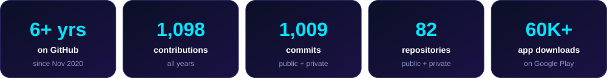
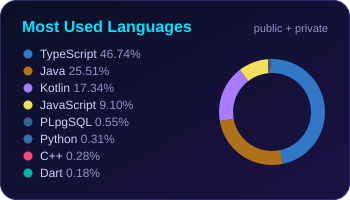
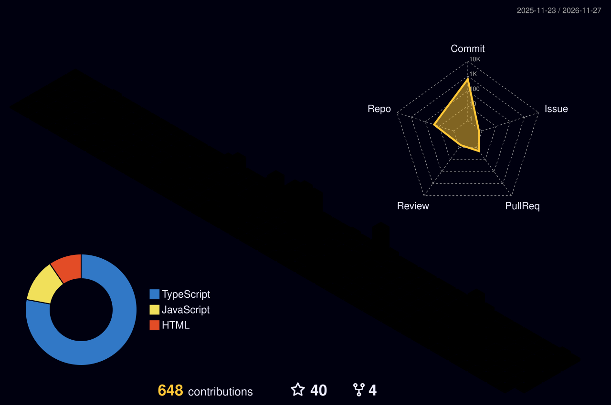

<!-- ═══════════════ HEADER ═══════════════ -->
<div align="center">


<a href="https://git.io/typing-svg">
  
</a>

<br/>


<br/><br/>

<a href="https://www.linkedin.com/in/madhwendra-shukla-77a13920b"></a>
<a href="mailto:madhwendrashukla37@gmail.com"></a>
<a href="https://x.com/MadhwendraShuk2"></a>
<a href="https://nova-unplugged.dbeos.in"></a>

</div>

<!-- ═══════════════ ABOUT ═══════════════ -->

## About Me

From Android apps to backend stacks: native apps in **Java and Kotlin**, cross-platform apps in **Flutter**, web apps in **Next.js and React**, and real-time backends on **Node.js, PostgreSQL and Socket.io**, with payments on **Razorpay** and deployment on **AWS**.

```yaml
name:       Madhwendra Shukla
education:
  - BBA, Digital Business & Entrepreneurship, IIM Bangalore
writing_code_since: 2021
builds_with: [Claude Code, Claude API, OpenAI API]
```

### What I Build
- Full-stack web platforms with payments, CMS and admin panels
- Android apps in Java and Kotlin, and cross-platform apps in Flutter
- Real-time backends with Node.js, PostgreSQL and Socket.io
- AI-first products, built fast with AI coding tools
- Ideas to live products in hours, not weeks

<!-- ═══════════════ PROJECTS ═══════════════ -->

## Featured Projects

| Project | What it is | Stack | Link |
|---|---|---|---|
| **Nova Unplugged** | Event portal for a college fest, idea to production in under 48 hours: ticketing, UTR payment verification, QR entry passes and email confirmations. | `Next.js` `TypeScript` `Supabase` `Tailwind` `Resend` | [Live](https://nova-unplugged.dbeos.in/) · [Code](https://github.com/madhwendrashukla/Nova-Unplugged) |
| **URL Tracker** | Free alternative to Bitly. Short links and custom QR codes with click analytics by device, OS and browser. | `Next.js` `TypeScript` `Prisma` `NextAuth` `shadcn/ui` `Recharts` | [Live](https://tss-tr.vercel.app/) · [Code](https://github.com/madhwendrashukla/Url-Tracker) |
| **₹250 Venture** | Browser game about bootstrapping: ₹250, 30 days, real market feedback and a verified leaderboard. | `React` `TypeScript` `Vite` `Express` `PostgreSQL` | [Live](https://250-ven-game.vercel.app/) · [Code](https://github.com/madhwendrashukla/250-ven-Game) |
| **Trash Truck Tracker** | Real-time GPS tracking for municipal waste trucks. Driver app, 4G hardware trackers, admin dashboard and citizen ETA lookup. Pitched to ADM Baghpat at their request. | `Flutter` `Node.js` `Socket.io` `Supabase` `Next.js` `Railway` `G11 4G GPS` | [Code](https://github.com/madhwendrashukla/E-Van-Tracker) |
| **Setu Startup School** | Founder-education platform: events, workshop registrations, payments and an admin CMS. | `Node.js` `Prisma` `PostgreSQL` `Razorpay` `AWS EC2` `AWS S3` `Nginx` | [setustartupschool.com](https://setustartupschool.com) |
| **PostPolish** | Rich-text editor that adds bold, italics and lists to LinkedIn posts. | `Next.js` `TypeScript` `TipTap` `Tailwind` | [Live](https://post-polish-linkedin.vercel.app/) · [Code](https://github.com/madhwendrashukla/PostPolish-Linkedin) |

### Live on Google Play

| App | What it is | Downloads | Link |
|---|---|---|---|
| **Sarkari Result: Govt Job Alert** | Government job notices, exam results, admit cards and answer keys in one app. | **50K+** | [Google Play](https://play.google.com/store/apps/details?id=com.governmentjobonline) |
| **HostelPedia** | Search and book hostels and PGs near campus. | **500+** | [Google Play](https://play.google.com/store/apps/details?id=com.hostelpedia) |
| **Birthday Wishes in Marathi** | Marathi birthday messages and shayari to copy or share on WhatsApp. | **10K+** | [Google Play](https://play.google.com/store/apps/details?id=in.papayacoders.valentineapp) |

### More Builds

| Project | What it is | Stack | Link |
|---|---|---|---|
| **Phone-Controlled Room Lights** | Android app that switches room lights through an ESP32 relay over Firebase. | `Kotlin` `Firebase` `ESP32` | [Code](https://github.com/madhwendrashukla/Android-App-Firebase-and-ESP32) |
| **USB Debugging Guard** | Android security check that blocks app use while USB debugging is on. | `Kotlin` `Android` | [Code](https://github.com/madhwendrashukla/Check-USB-Debugging-Enabled) |
| **Firestore Pagination** | Paginated Firestore lists in a native Android app. | `Kotlin` `Firestore` | [Code](https://github.com/madhwendrashukla/Fiestore-Pagination-with-Kotlin) |

<!-- ═══════════════ TECH STACK ═══════════════ -->

## Tech Stack

<div align="center">

**Languages**


**Frameworks & Mobile**


**Databases & Cloud**


**Tools & Hardware**


<br/>


</div>

<!-- ═══════════════ GITHUB STATS ═══════════════ -->

## GitHub Stats

<div align="center">



<br/><br/>




<br/>

</div>

### 3D Contribution Skyline

<div align="center">

<br/>
<sub>Every building is a day. The taller the tower, the more I shipped.</sub>
</div>

<!-- ═══════════════ CONNECT ═══════════════ -->

## Let's Connect

Building something with tech, or want a product taken from idea to production? I'm always up for a conversation.

<div align="center">

<a href="https://www.linkedin.com/in/madhwendra-shukla-77a13920b"></a>
<a href="mailto:madhwendrashukla37@gmail.com"></a>

<br/><br/>


</div>


