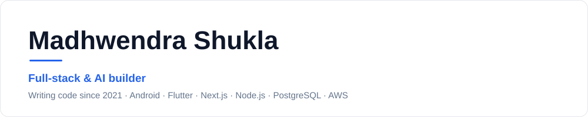
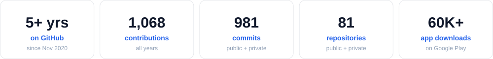

From Android apps to backend stacks: native apps in Java and Kotlin, cross-platform apps in Flutter, web apps in Next.js and React, and real-time backends on Node.js, PostgreSQL and Socket.io, with payments on Razorpay and deployment on AWS.

## Projects

<table>
  <tr>
    <td width="33%" valign="top">
      <h3>Nova Unplugged</h3>
      Event portal for a college fest: ticketing, UTR payment verification, QR entry passes and email confirmations.  
      <code>Next.js</code> <code>TypeScript</code> <code>Supabase</code> <code>Tailwind</code> <code>Resend</code> <code>QR scanner</code>  
      
      
    </td>
    <td width="33%" valign="top">
      <h3>URL Tracker</h3>
      Free alternative to Bitly. Short links and custom QR codes with click analytics by device, OS and browser.  
      <code>Next.js</code> <code>TypeScript</code> <code>Prisma</code> <code>NextAuth</code> <code>Tailwind</code> <code>shadcn/ui</code> <code>Recharts</code>  
      
      
    </td>
    <td width="33%" valign="top">
      <h3>₹250 Venture</h3>
      Browser game about bootstrapping: ₹250, 30 days, real market feedback and a verified leaderboard.  
      <code>React</code> <code>TypeScript</code> <code>Vite</code> <code>Express</code> <code>PostgreSQL</code> <code>Framer Motion</code> <code>Vitest</code>  
      
      
    </td>
  </tr>
  <tr>
    <td width="33%" valign="top">
      <h3>Trash Truck Tracker</h3>
      Live GPS tracking of municipal waste trucks, built with ADM Baghpat. Driver app, hardware GPS trackers, admin dashboard and citizen ETA lookup.  
      <code>Flutter</code> <code>Node.js</code> <code>Express</code> <code>Socket.io</code> <code>Supabase</code> <code>Next.js</code> <code>Railway</code> <code>G11 4G GPS module</code>  
      
      
    </td>
    <td width="33%" valign="top">
      <h3>Setu — The Startup School</h3>
      Founder-education platform: events, workshop registrations, payments and an admin CMS.  
      <code>Node.js</code> <code>Prisma</code> <code>PostgreSQL</code> <code>Razorpay</code> <code>AWS EC2</code> <code>AWS S3</code> <code>Nginx</code>  
      
    </td>
    <td width="33%" valign="top">
      <h3>PostPolish</h3>
      Rich-text editor that adds bold, italics and lists to LinkedIn posts.  
      <code>Next.js</code> <code>TypeScript</code> <code>TipTap</code> <code>Tailwind</code> <code>Vercel</code>  
      
      
    </td>
  </tr>
</table>

## Live on Google Play

<table>
  <tr>
    <td width="33%" valign="top">
      <h3>Sarkari Result: Govt Job Alert</h3>
      Government job notices, exam results, admit cards and answer keys in one app.  
      <b>50K+ downloads</b>  
      
    </td>
    <td width="33%" valign="top">
      <h3>HostelPedia</h3>
      Search and book hostels and PGs near campus.  
      <b>500+ downloads</b>  
      
    </td>
    <td width="33%" valign="top">
      <h3>Birthday Wishes in Marathi</h3>
      Marathi birthday messages and shayari to copy or share on WhatsApp.  
      <b>10K+ downloads</b>  
      
    </td>
  </tr>
</table>

## More builds

<table>
  <tr>
    <td width="33%" valign="top">
      <h3>Phone-Controlled Room Lights</h3>
      Android app that switches room lights through an ESP32 relay over Firebase.  
      <code>Kotlin</code> <code>Firebase</code> <code>ESP32</code> <code>Arduino</code>  
      
    </td>
    <td width="33%" valign="top">
      <h3>USB Debugging Guard</h3>
      Android security check that blocks app use while USB debugging is on.  
      <code>Kotlin</code> <code>Android</code>  
      
    </td>
    <td width="33%" valign="top">
      <h3>Firestore Pagination</h3>
      Paginated Firestore lists in a native Android app.  
      <code>Kotlin</code> <code>Firestore</code>  
      
    </td>
  </tr>
</table>

## Tech stack

**AI / LLM:** Claude API · OpenAI API

## Languages & activity

